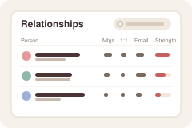

  

# People CRM

  

Didn't work? Create a Studio workspace and paste this to your agent:
` /use-template https://github.com/matthewboulos/people-crm`

## Why you care

A personal relationship view across your meetings and email, kept fresh by a daily sync of Google Calendar, Gmail and Contacts.

The people who matter to you are scattered across your calendar, your inbox and
your contacts, and none of them tells you who you have drifted away from. This
puts everyone in one list, ranked by how much you actually meet and write, so
you can see at a glance who you are close to and who you have not talked to in
months.

## How to use it

Once it is running, open **Relationships** from your desktop. The sync
runs every morning at 05:00 (ask your agent to run it right away the first
time; it takes about two hours).

- **The list.** One row per person: meetings, 1:1s, email threads, last
  contact, and a strength score. Click a column to sort; type in the search box
  to find a person, an address or a company.
- **Views.** Switch between *Everyone*, *Met & emailed*, and *Email-only*.
- **A person's detail.** Click a row to open their meetings and emails, each
  linking back to Google Calendar or Gmail.
- **Cleaning it up.** Hide a person, or a whole company by its domain, and
  give the reason (*Spam*, *Personal*, *Other*). Hidden people can be brought
  back from the *Filtering* panel. Your filters are never touched by a sync.
- **From the command line**, your agent can also run
  `people-crm show --email someone@example.com` to see one person's record, or
  `people-crm add-email --person <id> --email <address>` to attach another
  address to someone and pull in its history.

## Ideas for making it yours

- Add a "reconnect" view: people you used to meet often but have not seen in
  three months.
- Send yourself a weekly note listing the five relationships that have gone
  quietest.
- Sync a second calendar (a shared team calendar, say) by passing `--calendar`
  to the sync.
- Let the sync fetch emails in batches instead of one by one, to cut the
  two-hour first run down to minutes.
- Add notes and follow-up dates to a person's detail drawer.

## What this is

This repository is a published **Imbue Studio template**: a clean, bootable
snapshot of what an agent built, ready to adapt into your own. It is NOT the
generic workspace template -- it is this specific project.

[`template.md`](template.md) is the full manifest -- what it is, how it
works, what it needs to run, and what to adapt -- with the
machine-readable half (recipe, requirements, and the environment it needs
installed) in [`template.toml`](template.toml).
